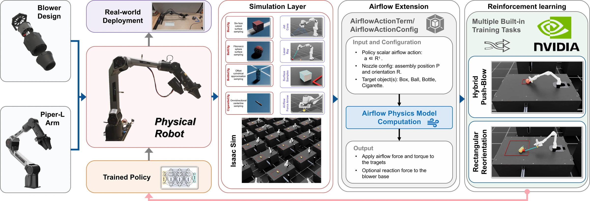
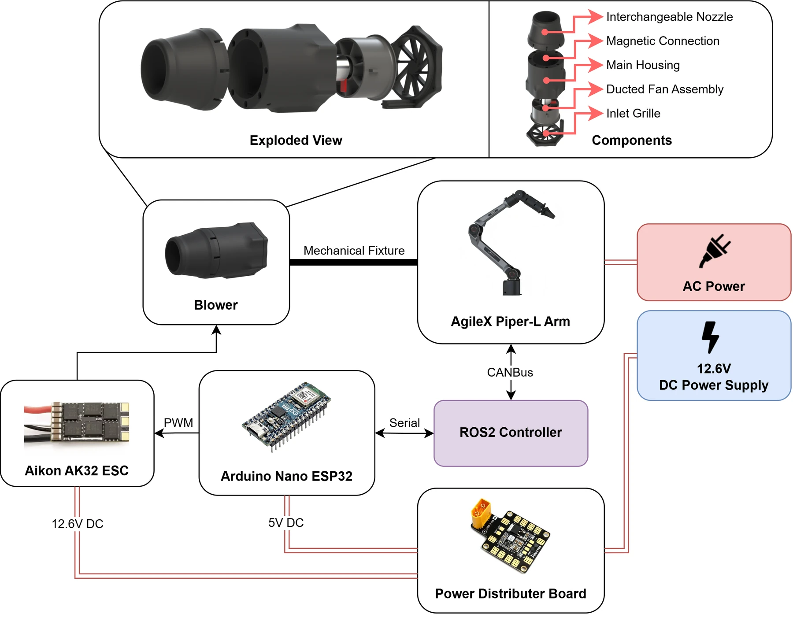
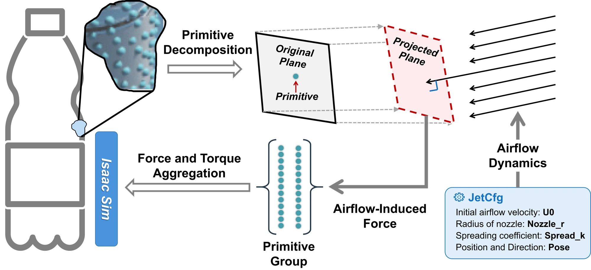
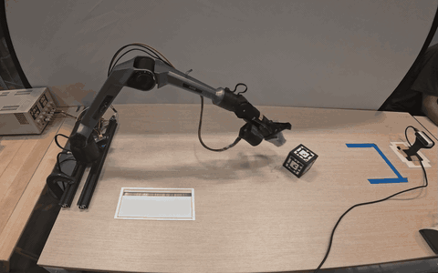
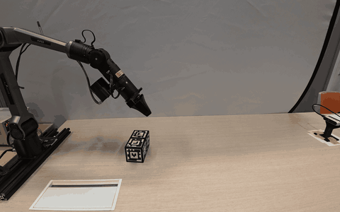
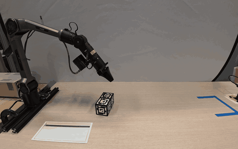
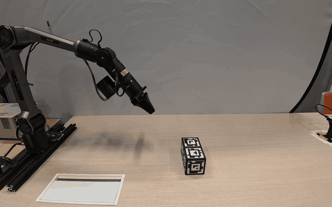
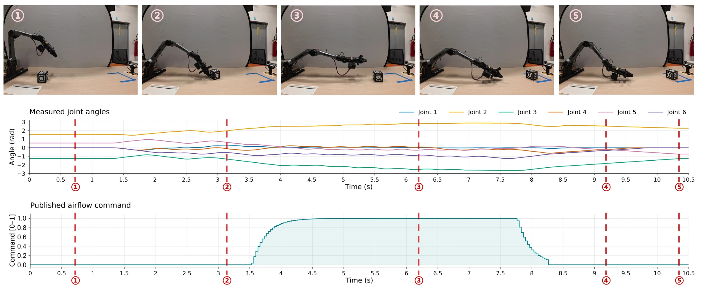
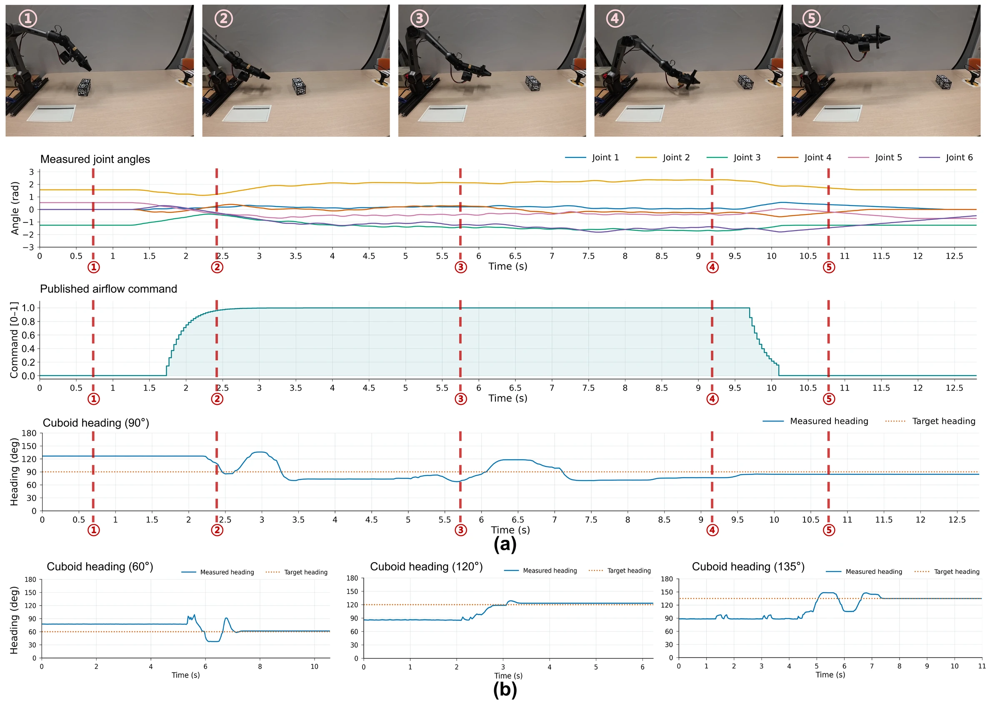

<div align="center">

# BeyondContact

### A Reinforcement Learning Framework for Airflow-Based Non-Contact Manipulation

Anonymous research release · Reinforcement learning · Grippers and other end-effectors, Non-contact manipulation

[Overview](#overview) · [Demonstrations](#demonstrations) · [Results](#experimental-results) · [Installation](#installation) · [Training](#train) · [Project website](#project-website)


</div>

## Overview

Contact-based manipulation depends on where a robot's gripper can reach. **BeyondContact adds directed airflow as a second way to act on an object**: a compact blower coexists with the gripper, while a learned policy controls the arm and airflow together.



The framework connects three components:

- **Gripper-compatible hardware.** A custom blower beneath the Piper-L gripper preserves contact manipulation and adds non-contact airflow actuation.
- **A reusable airflow extension.** Experimentally identified jet decay and radial spreading are mapped to object forces and torques through batched surface integration in Isaac Lab.
- **Two complementary learned skills.** Hybrid push–blow (HPB) combines pushing and blowing to transport objects beyond direct reach. Rectangular reorientation (RR) rotates a cuboid using airflow alone.

The paper evaluates **zero-shot sim-to-real deployment**, with no real-world policy fine-tuning.

| Real-world HPB success | Real-world RR heading error | Parallel training | HPB target distance |
| :---: | :---: | :---: | :---: |
| **80%** · 16 / 20 trials | **2.60°** mean absolute error · 4 headings | **4,096** environments | **1.3 m** from the robot base |

## Demonstrations

### Hybrid push–blow: contact + airflow

The policy first pushes the cube into a position suitable for blowing, then adjusts the nozzle direction and airflow to guide it into the target region. Once the cube arrives, the airflow command decreases to zero. For targets within gripper reach, the policy primarily uses contact-based manipulation.

[Watch / download the HPB compilation](docs/assets/hybrid-push-blow.mp4) · approximately 5 minutes. The animated demonstrations in [Results](#experimental-results) play automatically; the [project website](#project-website) also provides the full recording.

### Rectangular reorientation: airflow only

The robot continuously adjusts the blowing direction to rotate a cuboid toward a target heading. The task penalizes and terminates gripper–object contact, so heading control relies on airflow.

Real-world clips: [60°](docs/assets/rr-60.mp4) · [90°](docs/assets/rr-90.mp4) · [135°](docs/assets/rr-135.mp4). The paper also evaluates 120°; a corresponding video is not included in the supplied clips. Videos preserve their original speed and are served without audio.

## How it works

### Hardware

A **40 mm electric ducted fan** is housed in a 3D-printed enclosure beneath the gripper. A magnetic connection supports interchangeable nozzles; the evaluated nozzle has a **31.7 mm outlet**. An ESP32 microcontroller regulates the blower through an electronic speed controller.

The paper reports maximum hardware capabilities of **78 m/s air velocity** and **5.9 N static thrust**. These maxima differ from the lower settings used for airflow identification and training.



### Airflow modeling and surface integration

The extension represents a time-averaged, quasi-steady round jet using an identified centerline-decay function and Gaussian radial spreading. It supports cuboids, spheres, cylinders, and mesh-based objects from USD assets.

1. Sample each object's surface into positions, outward normals, and areas.
2. Evaluate local airflow velocity at each surface primitive.
3. Compute aerodynamic forces on surfaces facing the incoming jet.
4. Sum the forces and their moment arms into net force and torque; apply them through Isaac Sim / PhysX.

**Surface integration captures the torque caused by uneven airflow coverage**, which is essential for reorientation. The extension also supports an approximate reaction force on the link carrying the blower.



The paper compares exponential and shifted-inverse decay models. The shifted-inverse model achieves **0.895 m/s centerline RMSE** with the evaluated nozzle; the exponential model performs better for the bare fan, achieving **0.606 m/s RMSE**. The model does not explicitly resolve rotor swirl, instantaneous turbulence, or interactions with nearby environmental surfaces.

### Reinforcement learning

Both tasks use PPO with an asymmetric actor–critic. The actor receives observations available during deployment: ten-step joint position and velocity histories, object pose, the task goal, and previous actions. The critic also receives privileged simulation information.

- **Actions:** robot joint-position commands and airflow intensity.
- **Architecture reported in the paper:** actor and critic MLPs with `[512, 256, 128]` hidden dimensions and ELU activations.
- **Robustness:** domain randomization over object mass, friction, robot gains, and airflow parameters.
- **Rewards:** task progress and stable completion, with regularization for smooth arm motion and efficient airflow use.
- **Reported training setup:** 4,096 environments, 5,000 iterations, NVIDIA RTX 5090 and Intel U7 265K.

Paper settings describe the reported experiments. Check the [released PPO configuration](blower_arm_rl/source/blower_arm_rl/blower_arm_rl/tasks/manager_based/piper_blower_rl/agents/rsl_rl_ppo_cfg.py) and task configurations for current release defaults, which may differ.

## Experimental results

| Task | Simulation success | Real-world evaluation | Reported training time |
| --- | --- | --- | --- |
| Hybrid push–blow (HPB) | 88% | **80%** · 16 / 20 trials | 5.7 h |
| Rectangular reorientation (RR) | 92% | **2.60°** mean absolute heading error · 4 headings | 6.6 h |

### Real-world demonstrations

<table>
  <tr>
    <td width="50%" align="center">
      <strong>Hybrid push–blow</strong><br>HPB<br>
      
    </td>
    <td width="50%" align="center">
      <strong>Reorientation · 90°</strong><br>Airflow only<br>
      
    </td>
  </tr>
  <tr>
    <td width="50%" align="center">
      <strong>Reorientation · 60°</strong><br>Airflow only<br>
      
    </td>
    <td width="50%" align="center">
      <strong>Reorientation · 135°</strong><br>Airflow only<br>
      
    </td>
  </tr>
</table>

For HPB, the target is a **20 × 20 cm square centered 1.3 m in front of the robot base**. For RR, all four final headings are within the paper's **±10° tolerance**:

| Target heading | Final heading | Absolute error |
| :---: | :---: | :---: |
| 60° | 61.58° | 1.58° |
| 90° | 84.47° | 5.53° |
| 120° | 123.18° | 3.18° |
| 135° | 134.88° | 0.12° |

These are the evaluations reported in the supplied manuscript. The four RR headings are not a repeated-trial success-rate estimate; simulation success and real-world heading error are different metrics.

<details>
<summary>View deployment sequences and measured traces</summary>

**HPB:** measured joint angles and airflow command through pushing, blowing, and settling.



**RR:** the 90° deployment sequence, joint and airflow traces, and heading trajectories for the other evaluated targets.



</details>

The fixed 6-DoF arm limits the nozzle positions and directions available for recovery. HPB failures involved aggressive pushing or unintended contact during blowing. The paper proposes a mobile base or a 7-DoF arm as future directions for expanding the operating range and improving recovery.

## Included components

| Path | Contents |
| --- | --- |
| [`external_blower/blower`](external_blower/blower) | Reusable airflow model, surface integration, object assets, and visualization |
| [`blower_arm_rl`](blower_arm_rl) | Piper-L task configurations, PPO training, and checkpoint evaluation |
| [`docs`](docs) | Static project website and optimized presentation media |

Only the following tasks and their `-Play-v0` variants are registered:

| Paper task | Gym ID |
| --- | --- |
| Hybrid push–blow (HPB) | `Isaac-Blower-Piper-GripperAssistBoxPush-v0` |
| Rectangular reorientation (RR) | `Isaac-Blower-Piper-GripperAssistCuboidOrientation-v0` |

The RR task retains the `GripperAssistCuboidOrientation` code identifier for compatibility; its behavior is airflow-only reorientation. Shared base configurations and MDP utilities are retained as dependencies and do not register additional tasks.

**Release scope:** no pretrained checkpoints, training logs, real-robot deployment code, or fabrication-ready blower design files are bundled with the code release. Hardware figures describe the paper's system. Presentation figures and videos are available under `docs/assets/`.

## Installation

Use an isolated environment with **Isaac Sim 5.1.0**, a compatible Isaac Lab installation, **Python 3.11**, PyTorch, and RSL-RL. Simulator dependencies are not bundled. Follow the [Isaac Lab installation guide](https://isaac-sim.github.io/IsaacLab/main/source/setup/installation/index.html).

Run from this repository root using that environment's Python:

```bash
python -m pip install -e external_blower/blower/source/blower
python -m pip install -e blower_arm_rl/source/blower_arm_rl
python blower_arm_rl/scripts/list_envs.py
```

Editable installs are required because robot and object assets are resolved relative to the source checkout. Keep this checkout separate from other projects and use a separate environment if those projects install packages with the same names.

## Train

```bash
# Hybrid push–blow (HPB)
python blower_arm_rl/scripts/rsl_rl/train.py --task Isaac-Blower-Piper-GripperAssistBoxPush-v0 --headless

# Rectangular reorientation (RR)
python blower_arm_rl/scripts/rsl_rl/train.py --task Isaac-Blower-Piper-GripperAssistCuboidOrientation-v0 --headless
```

## Evaluate a trained checkpoint

Replace `/path/to/model.pt` with your trained checkpoint:

```bash
# Hybrid push–blow (HPB)
python blower_arm_rl/scripts/rsl_rl/play.py --task Isaac-Blower-Piper-GripperAssistBoxPush-Play-v0 --num_envs 1 --checkpoint /path/to/model.pt

# Rectangular reorientation (RR)
python blower_arm_rl/scripts/rsl_rl/play.py --task Isaac-Blower-Piper-GripperAssistCuboidOrientation-Play-v0 --num_envs 1 --checkpoint /path/to/model.pt
```

## Checks

```bash
python external_blower/blower/examples/check_airflow_model.py
python -m pytest blower_arm_rl/test -q
```

Run simulator training in the compatible Isaac Sim / Isaac Lab environment described above.

## Project website

The research page opens with looping real-world demonstrations and includes selectable RR target headings, expandable full recordings, hardware and airflow figures, quantitative results, and setup commands. It uses local assets and requires no frontend build step.

```bash
python -m http.server 8000 --directory docs
```

Visit **http://localhost:8000**. The site is self-contained in `docs/`, including its optimized figures, looping GIFs, and H.264 videos. README images reuse these same assets. Original high-resolution materials are kept locally in `figs/`, which is excluded from Git through `.gitignore`; this directory is not required to serve the site.

During anonymous review, share the site through an anonymous project URL. After the anonymous review stage, the `docs` folder can be used as the GitHub Pages publishing root.

## Third-party notices

Existing third-party copyright and SPDX notices are preserved. This release does not assign a new blanket license to third-party code or assets.
